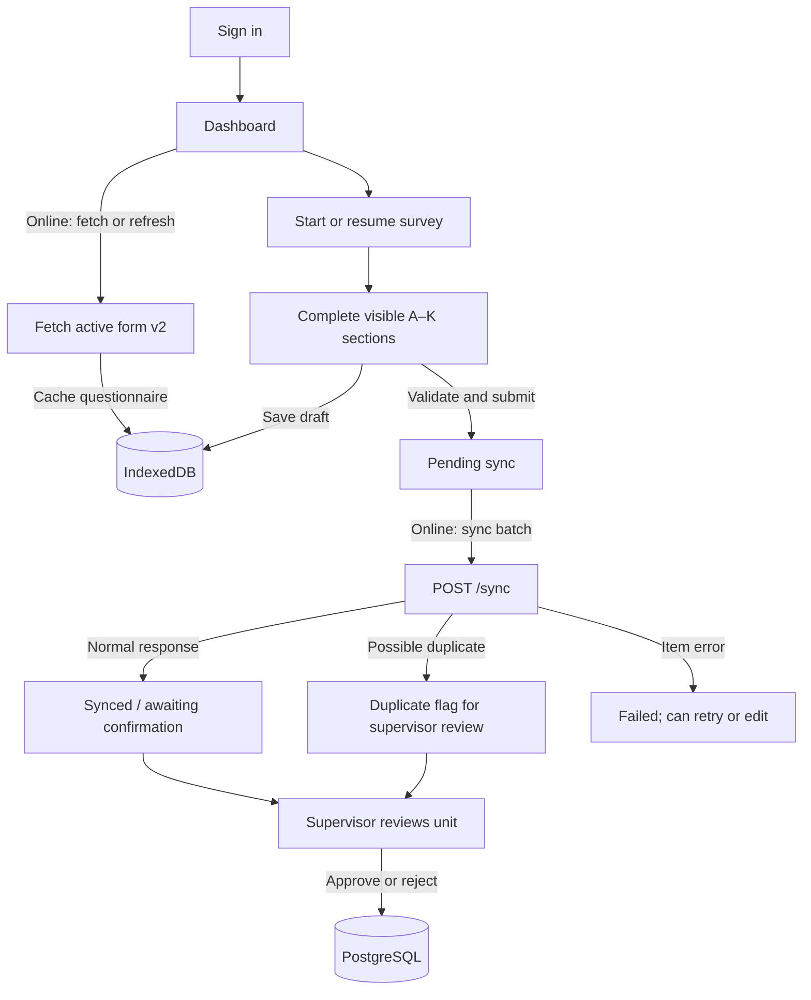

# Application Flow

Punjab Industrial Survey is an offline-first Progressive Web App for field survey capture, synchronization, and supervisor review.

## Roles and routes

| Role | Main use |
|---|---|
| `SURVEYOR` | Fill the A–K survey, save drafts, submit completed responses, and sync when online. |
| `SUPERVISOR` | Fill surveys and review industrial units awaiting confirmation. |
| `ADMIN` | Manage user accounts and use the survey and review flows permitted by the assigned permissions. |

The client routes are `/login`, `/dashboard`, `/surveys`, `/surveys/new`, `/surveys/:id`, `/sync`, `/supervisor`, `/supervisor/units/:id`, and `/admin`. All routes except login are wrapped in the authenticated application layout. API authorization is enforced separately by the backend JWT/RBAC guard.

## Survey lifecycle

## Sign-in and form download

1. The login screen sends credentials to `POST /auth/login`. The API compares the password with its bcrypt hash and returns a JWT plus the user profile and permissions.
2. The client keeps the JWT and user in `localStorage` and attaches the token to subsequent API requests. A 401 response clears the local session.
3. After authentication, the client loads the cached form from IndexedDB and requests `GET /survey-forms/active` when online.
4. The client requires form version 2. A version-1 or older cached form is not used for new captures; the dashboard reports a download error if the server has not been migrated.
5. The API returns the active form, its 11 ordered sections, question definitions, lookup options, compound field metadata, and matrix rows. The PWA caches the response for offline use.

## Completing a survey

- The questionnaire contains the registered question set for Sections A–K (86 question records in the active version-2 database snapshot). Compound and repeatable questions render their child fields and rows from backend metadata.
- Supported controls include text, number, yes/no, single and multiple choice, share percentages, month selection, GPS capture, repeatable groups, and matrix choice/rating rows.
- Conditional fields include parent-company information, closure and disruption/demand-gap reasons, and the Section K future-plan follow-ups.
- The application validates visible required questions and required fields in rows before advancing or submitting. Earlier incomplete sections are surfaced before final submission.
- Drafts and submitted-but-not-synced responses are stored in IndexedDB. A surveyor can download a PDF from the final survey review area; the PDF is generated on the device from the local response.

## Offline storage and synchronization

IndexedDB database `survey-pwa` contains:

| Store | Contents |
|---|---|
| `survey_form` | Cached active questionnaire, keyed by `form_id`. |
| `offline_responses` | Drafts and captured responses, keyed by `response_id` and indexed by sync status. |
| `sync_log` | Client-side history of sync attempts and their item results. |

When online, the Sync page sends pending responses to `POST /sync` with the device ID, form ID, timestamps, GPS and question-ID/answer-value pairs. The backend validates submitted question IDs against the form, processes each response transactionally, and writes normalized records to their Section A–K tables.

The server checks for a response ID already present before processing, detects nearby/name-similar units when GPS is available, and records suspected duplicates in `duplicate_flags`. Each item returns `synced`, `duplicate_flagged`, `already_synced`, or `failed`. Successful and already-synced items are marked synced locally; failed items remain available for correction or retry.

## Supervisor review

The Supervisor page loads units from `GET /industrial-units`. Unit detail pages can call:

- `POST /industrial-units/:id/approve` — mark the unit confirmed and write an approval-log entry.
- `POST /industrial-units/:id/reject` — mark the unit rejected and write an approval-log entry.

These review actions require `SURVEY_CONFIRM`. The sync endpoint creates response records in `PENDING_CONFIRMATION`; sync completion alone does not mean supervisor confirmation. Suspected duplicates are also recorded for review.

## API route summary

| Method | Route | Access |
|---|---|---|
| `POST` | `/auth/login` | Public |
| `POST` | `/auth/register` | `USER_CREATE` |
| `GET` | `/auth/users` | `USER_CREATE` |
| `PATCH` | `/auth/users/:id/status` | `USER_REMOVE` |
| `GET` | `/auth/me` | Authenticated |
| `GET` | `/survey-forms/active` | `SURVEY_SUBMIT` |
| `POST` | `/sync` | `SURVEY_SUBMIT` |
| `GET` | `/industrial-units` | Authenticated |
| `GET` | `/industrial-units/:id` | Authenticated |
| `POST` | `/industrial-units/:id/approve` | `SURVEY_CONFIRM` |
| `POST` | `/industrial-units/:id/reject` | `SURVEY_CONFIRM` |
