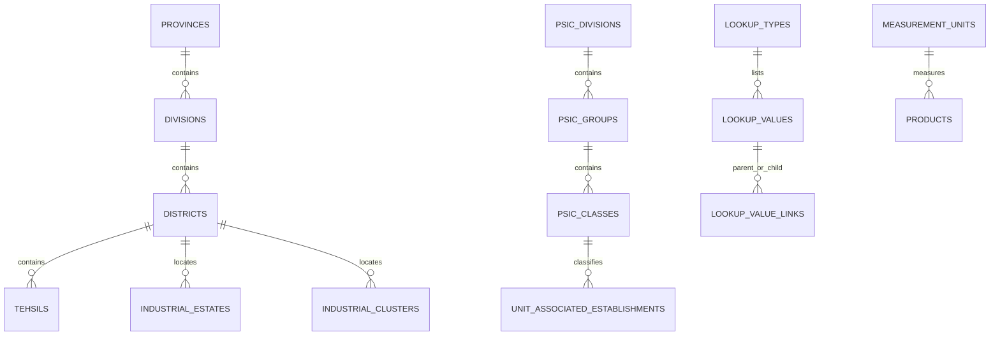

# Database Diagram and Structure

This ER overview reflects [`../database/schema.sql`](../database/schema.sql) and the current application write path. The deployed questionnaire is version 2, with A–K responses linked through `survey_responses`.

## Core entity relationships

```mermaid
erDiagram
    ROLES ||--o{ USERS : assigns
    USERS ||--o{ USERS : supervises
    ROLES ||--o{ ROLE_PERMISSIONS : grants
    PERMISSIONS ||--o{ ROLE_PERMISSIONS : includes

    SURVEY_FORMS ||--o{ SURVEY_SECTIONS : contains
    SURVEY_SECTIONS ||--o{ SURVEY_QUESTIONS : registers
    SURVEY_QUESTIONS ||--o{ MATRIX_ITEMS : defines
    LOOKUP_TYPES ||--o{ LOOKUP_VALUES : categorizes
    LOOKUP_VALUES ||--o{ LOOKUP_VALUE_LINKS : links

    INDUSTRIAL_UNITS ||--o{ SURVEY_RESPONSES : surveyed_in
    SURVEY_FORMS ||--o{ SURVEY_RESPONSES : uses
    USERS ||--o{ SURVEY_RESPONSES : completes
    INDUSTRIAL_UNITS ||--o| UNIT_PARENT_COMPANIES : may_have
    INDUSTRIAL_UNITS ||--o{ UNIT_ASSOCIATED_ESTABLISHMENTS : includes
    INDUSTRIAL_UNITS ||--o{ UNIT_APPROVAL_LOG : has_history

    SURVEY_RESPONSES ||--o| SEC_B_OPERATIONS : answers
    SURVEY_RESPONSES ||--o{ PRODUCTS : answers
    SURVEY_RESPONSES ||--o{ WORKFORCE_EMPLOYMENT : answers
    SURVEY_RESPONSES ||--o{ WORKFORCE_SKILLS : answers
    SURVEY_RESPONSES ||--o| SEC_E_SUPPLY_CHAIN : answers
    SURVEY_RESPONSES ||--o{ MAJOR_INPUTS : answers
    SURVEY_RESPONSES ||--o| SEC_F_MARKET : answers
    SURVEY_RESPONSES ||--o| SEC_G_TECHNOLOGY : answers
    SURVEY_RESPONSES ||--o| SEC_H_ENVIRONMENT : answers
    SURVEY_RESPONSES ||--o| SEC_I_COMPLIANCE : answers
    SURVEY_RESPONSES ||--o| SEC_J_STRATEGY : answers
    SURVEY_RESPONSES ||--o| SEC_K_FUTURE : answers
    SURVEY_RESPONSES ||--o{ RESPONSE_CHOICES : stores
    SURVEY_RESPONSES ||--o{ RESPONSE_SHARES : stores
    SURVEY_RESPONSES ||--o{ RESPONSE_MATRIX_ANSWERS : stores
    SURVEY_RESPONSES ||--o{ SURVEY_ATTACHMENTS : references
    SURVEY_RESPONSES ||--o{ RESPONSE_EDIT_LOG : tracks
    SURVEY_RESPONSES ||--o{ COLLABORATIONS : records
    COLLABORATIONS ||--o{ COLLABORATION_PURPOSES : has
    INDUSTRIAL_UNITS ||--o{ DUPLICATE_FLAGS : may_be_flagged
    USERS ||--o{ SYNC_LOG : starts
```

`SYNC_LOG` is a sync-batch record linked to the surveyor/device, not a parent record for individual responses. A batch can contain multiple responses, and the SQL schema does not put a `sync_log_id` foreign key on `survey_responses`.

## Table groups

The database contains 64 application tables. The connected database snapshot reports 65 base tables because PostGIS also installs `spatial_ref_sys`.

| Area | Tables |
|---|---|
| Accounts and permissions | `roles`, `permissions`, `role_permissions`, `users` |
| Geography | `provinces`, `divisions`, `districts`, `tehsils` |
| Classification and measurement | `psic_divisions`, `psic_groups`, `psic_classes`, `hs_codes`, `measurement_units` |
| Forms and lookups | `survey_forms`, `survey_sections`, `survey_questions`, `matrix_items`, `lookup_types`, `lookup_values`, `lookup_value_links` |
| Establishment identity (A) | `industrial_units`, `industrial_estates`, `industrial_clusters`, `unit_parent_companies`, `unit_associated_establishments` |
| Response lifecycle | `survey_responses`, `survey_attachments`, `response_edit_log`, `unit_approval_log` |
| Operations, products, workforce (B–D) | `sec_b_operations`, `products`, `product_transformation_stages`, `workforce_employment`, `workforce_skills` |
| Supply and markets (E–F) | `sec_e_supply_chain`, `major_inputs`, `sec_f_market` |
| Technology and environment (G–H) | `sec_g_technology`, `critical_machines`, `machinery_age_profile`, `boilers_pressure_vessels`, `weights_measures_equipment`, `sec_h_environment`, `energy_consumption`, `energy_generation`, `solid_waste_streams`, `solid_waste_disposals` |
| Compliance, strategy, future (I–K) | `sec_i_compliance`, `sec_j_strategy`, `sec_k_future`, `collaborations`, `collaboration_purposes` |
| Generic answers | `response_choices`, `response_shares`, `response_matrix_answers` |
| Sync and GIS | `sync_log`, `duplicate_flags`, `gis_quality_log`, `base_map_layers` |
| Audit and reporting support | `audit_log`, `backup_log`, `system_settings`, `dashboard_kpi_definitions`, `dashboard_saved_filters` |

## Reference-data relationships

These reference tables exist in the schema. The application currently accepts text for geography, PSIC, HS code, estate, and cluster entries because the corresponding official datasets are not loaded; the migration made the geography foreign keys nullable and added text columns. See [Database Design](./database_design.md).

## Section records

Most section records reference `survey_responses.id`; one-to-one section tables use `response_id` as their primary key, while repeating data tables have their own primary key and response foreign key. Section A is stored against the establishment master (`industrial_units`) and its related identity tables.

| Section | Data tables |
|---|---|
| A | `industrial_units`, `unit_parent_companies`, `unit_associated_establishments` |
| B | `sec_b_operations` |
| C | `products`, `product_transformation_stages` |
| D | `workforce_employment`, `workforce_skills` |
| E | `sec_e_supply_chain`, `major_inputs` |
| F | `sec_f_market` |
| G | `sec_g_technology`, `critical_machines`, `machinery_age_profile`, `boilers_pressure_vessels`, `weights_measures_equipment` |
| H | `sec_h_environment`, `energy_consumption`, `energy_generation`, `solid_waste_streams`, `solid_waste_disposals` |
| I | `sec_i_compliance` |
| J | `sec_j_strategy` |
| K | `sec_k_future`, `collaborations`, `collaboration_purposes` |

The application writes multi-select, share, and matrix answers to generic response tables. It writes compound and repeating fields to their corresponding normalized tables. All writes for one synced response occur inside a database transaction.

## Status and integrity

- `survey_responses.status` tracks `DRAFT`, `PENDING_CONFIRMATION`, `CONFIRMED`, `RETURNED`, or `REJECTED`.
- `survey_responses.sync_status` separately tracks `PENDING`, `SYNCED`, `REJECTED`, or `DUPLICATE`.
- `duplicate_flags` links a newly captured unit to a possible matching unit and records the reason, similarity, distance, and resolution.
- Database checks, unique constraints, and triggers enforce valid answer forms, option membership, rating/share bounds, product constraints, and confirmation rules.
- The schema defines three materialized dashboard views and a percentage-check view.

## Applying schema changes

For a fresh database, apply `database/schema.sql` followed by `database/seed.sql`. To upgrade an existing version-1 survey database, apply `database/migrate_full_questionnaire.sql`. `synchronize` is disabled in TypeORM; SQL files are authoritative for DDL.
